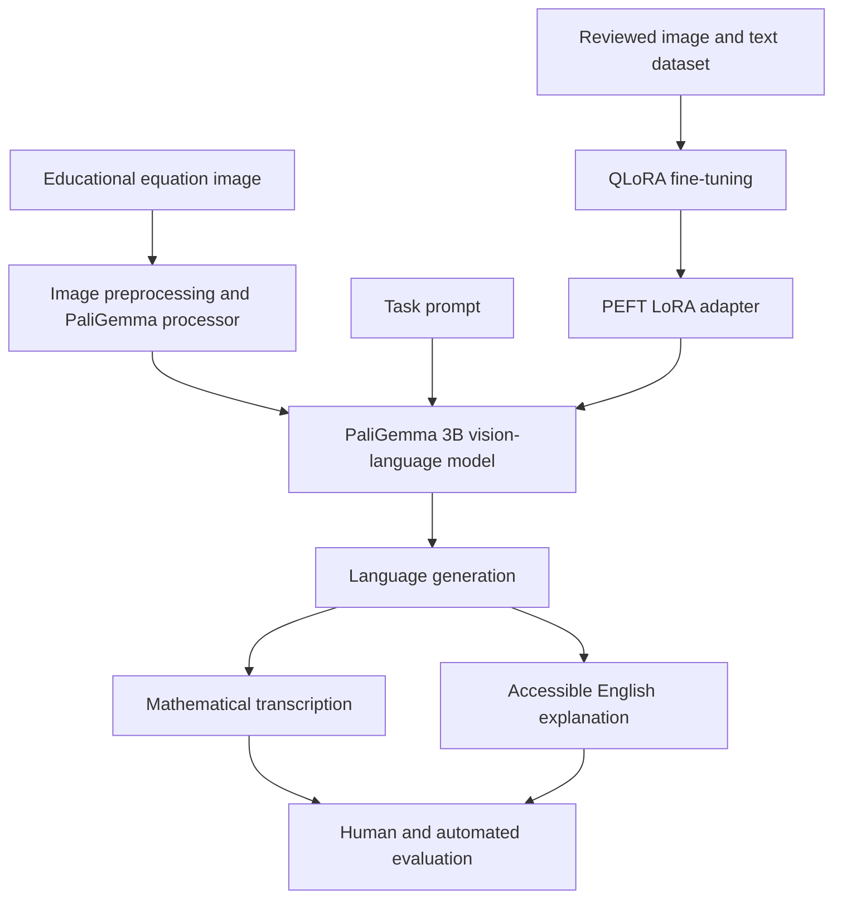

# EduRead V3 — System Architecture

## 1. Project overview

EduRead is an accessibility-focused vision-language capstone exploring image understanding and mathematical descriptions for visually impaired students.

The audited V3 workflow uses **PaliGemma 3B** (`google/paligemma-3b-pt-448`). Do not confuse this V3 base model with separate Gemma 3 4B IT experiments.

## 2. Architecture

## 3. Components

| Component | Responsibility |
|---|---|
| Input | Educational images containing mathematical expressions |
| Processor | Converts image and prompt to model inputs |
| Vision-language model | Interprets image and generates text |
| Dataset | Paired image, prompt, and target examples |
| Fine-tuning | QLoRA with PEFT LoRA adapters |
| Inference | Produces transcription or accessible explanation |
| Evaluation | Checks token metrics, mathematical fidelity, clarity, and accessibility |
| Demo interface | Gradio prototype, when implemented and tested |

## 4. Audited V3 model and training configuration

- Base model: `google/paligemma-3b-pt-448`
- Model class: `PaliGemmaForConditionalGeneration`
- Image resolution: 448 × 448
- Fine-tuning: QLoRA / PEFT
- Quantization: 4-bit NF4, double quantization enabled
- Compute precision: FP16
- LoRA rank: 8
- LoRA alpha: 16
- LoRA dropout: 0.05
- Target modules: `q_proj`, `v_proj`
- Training records: 160
- Evaluation records: 40
- Epochs: 3
- Optimizer updates: 120 total

The reference values are documented from the audited V3 run. Consult the notebook and saved training summary before reproducing a run.

## 5. Data flow

1. Select an educational mathematical image.
2. Apply the task-specific prompt.
3. Process image and text with the PaliGemma processor.
4. Generate mathematical transcription or accessible explanation.
5. Review output for correctness, completeness, and accessibility.
6. Record evaluation results and limitations.

## 6. Repository boundaries

- `src/eduread/`: reusable Python package code as it is extracted and tested.
- `notebooks/`: research and Colab workflow.
- `configs/`: documented configuration.
- `data/`: manifests, schema documentation, and reviewed public samples only.
- `evaluation/`: evaluation protocol and reports.
- `tests/`: deterministic tests that do not require model downloads.
- `outputs/`: local-only training outputs, ignored by Git.

## 7. Artifact storage

Keep private datasets, model weights, LoRA adapters, checkpoints, and credentials outside the public repository. The audited adapter was stored in Google Drive. Do not commit it to GitHub.

## 8. Responsible AI and accessibility

Generated mathematical explanations can omit or misinterpret symbols, variables, units, and relationships. Outputs require appropriate review. Do not claim formal accessibility validation or production readiness without evidence.

## 9. Known V3 limitations

See [V3 Dataset Integrity Audit](V3_DATASET_INTEGRITY_AUDIT.md). In particular, the audit identified two exact normalized equation overlaps across training and evaluation, training redundancy, and no evaluation examples for linear algebra or logarithms.
